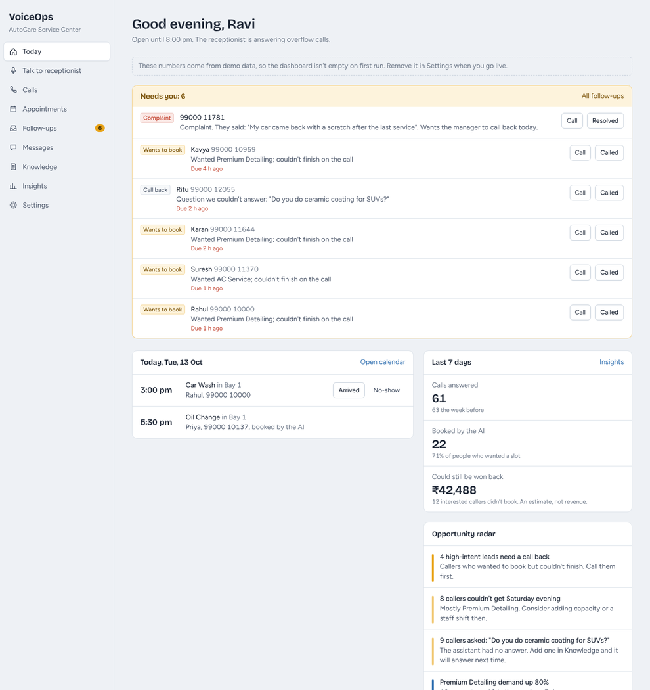
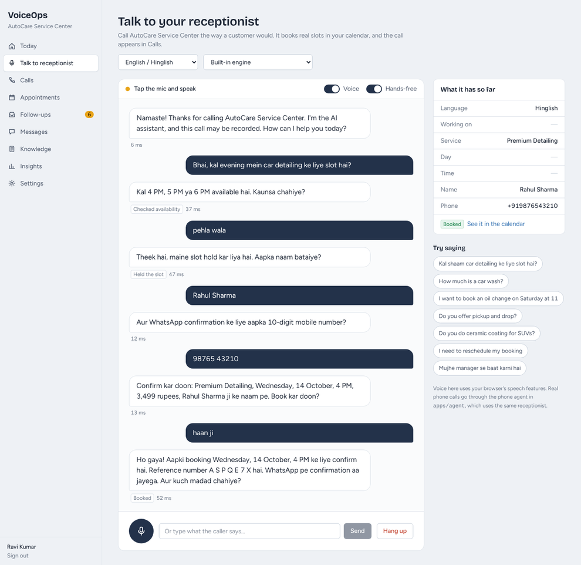

# VoiceOps AI

An AI front desk for small businesses in India. It answers calls in English, Hindi and Hinglish, books appointments without ever double-booking, follows up on the calls it can't finish, and tells the owner where they're losing customers.



**Runs on your laptop with two commands. No Docker, no database to install, no API keys.**

```bash
pnpm install
pnpm dev
```

Open http://localhost:5173 and click **Try the demo** (owner@autocare.example / demo1234), or **Set up your business** to create your own. A short guide opens on first sign-in; Help in the sidebar reopens it.

---

## What it does

| | |
| --- | --- |
| **Answers** | Talks to callers in English, Hinglish or Hindi. Understands "kal shaam saade chhe baje", "parso", "doosra wala". |
| **Books safely** | Checks real availability, holds the slot while the caller confirms, reads it back, and only books after a clear "yes". The database itself makes double bookings impossible. |
| **Changes and cancels** | Finds the caller's booking by phone number, applies your notice rules, moves or cancels it. |
| **Answers questions honestly** | Only from your FAQ list. If it doesn't know, it says so, offers a call back, and logs the question for you. |
| **Recovers lost customers** | Full slot? Offers alternatives, then a waitlist. When someone cancels, the slot is offered on WhatsApp and the first "YES" gets it. |
| **Hands off to people** | Complaints and "let me talk to someone" go to your inbox with a summary, plus a WhatsApp alert. |
| **Reminds** | WhatsApp confirmation, reminders a day and 2 hours before, and an evening summary for the owner. |
| **Shows what's happening** | Why people call, when, which times you're turning people away, questions you can't answer, and an estimate of the business you could still win back (with the formula shown). |



## Accounts and roles

- **Sign-up** creates a business, its owner account and a starting setup (car service template or empty).
- **Owners** change settings, manage the team (add people, change roles, reset passwords, remove) and demo data. **Staff** handle calls, bookings, follow-ups and knowledge.
- Sessions are signed cookies, re-checked against the database on every request: removing someone or changing a password signs them out immediately.
- Sign-in is rate-limited per IP and per account. The demo login is off when `NODE_ENV=production` (set `DEMO_LOGIN=true` to keep it); `SIGNUP_ENABLED=false` closes sign-up.
- **Bookings from the web Talk page are requests**: the slot is reserved, and staff confirm or decline them on Today, because a web caller can type anyone's number. Phone calls (trusted caller ID) confirm immediately.

## Quick start on Windows: double-click

1. Install **Node.js LTS** (22.9 or newer) from https://nodejs.org if you don't have it.
2. Double-click **`Start VoiceOps.bat`** in this folder.
3. Wait for the browser to open (the first start takes a few minutes), then click **Try the demo**.

Keep the black window open while you use the app; closing it stops VoiceOps. Everything it prints is also saved to `voiceops-log.txt`, which is the file to send if something goes wrong.

## Quick start (Windows, macOS, Linux)

You need **Node.js 22.9 or newer** (https://nodejs.org) and **pnpm**:

```bash
npm install -g pnpm
```

Then in the project folder:

```bash
pnpm install
pnpm dev
```

- Dashboard: http://localhost:5173 (Try the demo, or set up your own business)
- Try a call: open **Talk to receptionist**, press **Start a call**, and speak (Chrome or Edge) or type.

The first start creates a built-in database in `apps/api/.data`, a demo business (AutoCare Service Center) and four weeks of demo calls so the dashboard isn't empty. Remove the demo data in **Settings** when you're ready.

### Commands

| Command | What it does |
| --- | --- |
| `pnpm dev` | API (port 4000) and dashboard (port 5173) with live reload |
| `pnpm test` | All tests: booking engine, receptionist conversations, API, dashboard |
| `pnpm eval` | Scenario evaluation: 33 scripted callers, scored on what ended up in the database |
| `pnpm build` then `pnpm start` | Production build; one process serves API and dashboard on port 4000 |
| `pnpm db:reset` | Delete the local database; the next start creates a fresh one |
| `pnpm typecheck` | TypeScript checks across the repo |

### Optional connections

Everything works without these. Copy `.env.example` to `.env` to add them.

| Add | What changes |
| --- | --- |
| `LLM_API_KEY` (+ `LLM_BASE_URL`, `LLM_MODEL`) | "AI model" engine appears on the Talk page. Any OpenAI-compatible API; Groq and Gemini have free tiers. |
| `WHATSAPP_PHONE_NUMBER_ID` + `WHATSAPP_ACCESS_TOKEN` | Confirmations, reminders and offers are really sent instead of shown as "Not sent". |
| `DATABASE_URL` | Use a Postgres server instead of the built-in database. |
| LiveKit + speech keys | Real phone calls through `apps/agent`. See [docs/going-live.md](docs/going-live.md). |

## How it's built

```
apps/web      React + Vite + Tailwind dashboard and talk page
apps/api      Node.js + Express + Drizzle: receptionist, booking engine, jobs, API
apps/agent    Python LiveKit agent for phone calls (sends speech to the API)
packages/shared  Code shared by web and API
docs/         Architecture, decisions, going live
```

The one rule the whole design follows: **the AI talks; the backend decides.** The receptionist (rules engine or an LLM) can only act through 12 tools. Every booking goes through the same pipeline: validation, idempotency, business rules, a check that the caller's last words were a "yes", and a database constraint that rejects overlapping bookings. Details in [docs/architecture.md](docs/architecture.md).

## Quality

- **149 API tests** run against an in-memory Postgres (and against a real Postgres server in CI): Hinglish date/time parsing, availability, 20 simultaneous callers racing for one slot, idempotent retries, policies, the confirmation gate, full scripted calls, the WhatsApp waitlist loop, tenant isolation.
- **33 evaluation scenarios** (`pnpm eval`) covering bookings, Hinglish, full slots, changes, FAQs, handoffs and garbled input. They are written by us, so a pass rate here is a regression check, not real-world accuracy. Add a scenario for every real call that goes wrong.
- Web and agent tests, plus GitHub Actions CI.

## Troubleshooting

- **`pnpm` not found**: run `npm install -g pnpm`, then open a new terminal.
- **Port 4000 or 5173 in use**: stop the other program, or set `API_PORT` in `.env`.
- **"Can't reach the server" in the dashboard**: the API stopped; check the terminal running `pnpm dev`.
- **Microphone doesn't work**: use Chrome or Edge, open the page at `http://localhost:5173` (not an IP address), and allow the microphone when asked; if you blocked it, click the icon at the left of the address bar to allow it. Chrome's voice input needs an internet connection. Typing always works, and the status line above the conversation says when it's your turn.
- **The receptionist's voice cuts off or sounds robotic**: that's the browser's built-in voice. Installing the Windows "English (India)" or "Hindi" speech pack (Settings, Time & language, Speech) gives a better local voice, which the page uses automatically.
- **Start completely fresh**: `pnpm db:reset`, then `pnpm dev`.
